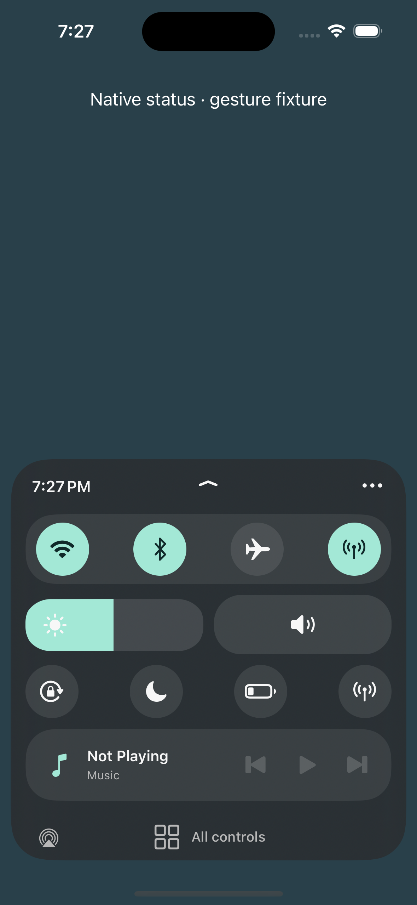

# Harbor

An original, free Control Center sheet for Chase’s iPhone. **0.1.0~beta7 is a development beta. Physical-device behavior remains unverified.** See the [publication record](docs/PUBLICATION.md) for package and deployment checks.

The design follows the compact organization in Chase’s supplied Prysm screenshots and the official [Prysm](https://havoc.app/package/prysm) and [Jade](https://chariz.com/buy/jade) references: controls first, horizontal sliders, a narrow music strip, and an expandable bottom sheet. No proprietary code, graphics, or screenshots are included in the package.



This is a **simulator fixture**, with a labeled synthetic status header and simulated native buttons. Its colored states do not represent a phone’s radio state. The simulator has no usable hardware volume route, so its volume pill opens the native panel.

## This version

- A live editor with independent compact/expanded arrangements, a pinned preview, drag handles and group visibility. Save commits a draft; Cancel preserves the saved profile. Native recovery controls remain available.
- Up to 12 named profiles, four theme presets, custom accent/surface colors, materials, button shapes, opacity, sheet radius and spacing. Saved profiles can be copied, switched, reset or deleted.
- Focus matching is **off by default**. Turn on Match Focus automatically and Save to opt into Harbor's read-only matching. Old enabled flags and backup recovery cannot grant access. While off, Harbor creates no reader; manual profiles remain usable. Turning off pauses immediately; Save keeps it off, while Cancel restores the saved choice. [Beta7 audit and evidence](docs/BETA7-FOCUS-OPT-IN.md) explain the beta6 access-gate bug, fix and residual risks.
- Optional Focus matching uses exact returned identifiers and safe default fallback. **The real simulator app service rejects access; actual SpringBoard Focus integration remains unverified.** Labeled fixture events validate transitions and interruption behavior. The native Focus shortcut is separate: it opens Apple's controls, where the user can deliberately change Focus.
- Focus reads have independent request deadlines, stale-response rejection and bounded retries. Optional mode discovery cannot delay publishing a valid state. The editor's Focus tab includes a scrolling diagnostics report, Copy and manual Refresh. The simulator daemon's explicit entitlement rejection and recovery checks are recorded in the [beta6 investigation](docs/BETA6-FOCUS.md).

- A rounded translucent sheet anchored above the home indicator. Normal compact controls fit without scrolling. Tap the chevron, or drag it upward, to reveal more shortcuts; short screens and larger text can scroll inside the sheet. All controls remains outside that scroll area.
- Wi-Fi, Bluetooth, Airplane Mode, Cellular Data, Rotation Lock and Low Power Mode forward the existing Apple UIControl actions and read their state. No invented radio state, private radio setters, or moved native views. If the loaded controls cannot be resolved, Connections or the native control list is offered instead. **Real device resolution and effects remain unverified.**
- Horizontal brightness and native MPVolumeView controls, native AirPlay picker, and MediaRemote artwork/title/play/pause/skip. Empty media disables transport. Narrow layouts expose previous/next through the track’s VoiceOver actions.
- Focus, Connections, and expanded shortcuts for flashlight, timer, calculator, camera, recording, remote, hearing and display use the native module presentation path. These shortcuts open the existing system controls; they do not start recording or launch protected functions themselves.
- 120 ms press feedback, a restrained 200 ms expansion, Reduce Motion/Transparency, Dynamic Type and VoiceOver. The native opening animation remains owned by Control Center.
- Settings → Harbor: enable, gentle haptics, and a versioned last-event report from SpringBoard. Open the in-sheet ellipsis → Edit layout & theme for layout, theme, profiles and Focus links.

The full-window native scroll ancestry and background remain intact. ABI-checked Control Center gesture delegate hooks reject native scroll/dismiss recognizers only for Harbor’s interactive sheet. Header, blank-area and screen-edge gestures stay on Apple’s path. No gesture delegate is replaced, no recognizer is disabled, and no window or lock-screen policy is created or changed.

The per-frame native scroll hook now only synchronizes the dashboard frame. It does not rebuild layout, rescan modules or format status reports. Media and state timers pause during tracking and stop on dismissal/handoff; artwork is decoded on a background queue.

## Build and inspect

```sh
bash scripts/check.sh
bash scripts/build.sh
bash scripts/verify-package.sh
```

Requires Xcode, RootHide-capable Theos (`$THEOS`, default `/Users/chase/theos`), the iPhoneOS17.0 SDK, ldid and dpkg-deb. The package build runs in /tmp to avoid Theos’s path-with-spaces limitation.

Output: `packages/com.chasedavis.harbor_0.1.0~beta7_iphoneos-arm64e.deb`. Debian architecture is iphoneos-arm64e; both binaries contain arm64 and arm64e slices. The package uses the RootHide layout and relocatable .jbroot library paths, with no install/respring scripts.

## Device requirements and operation

Target firmware remains **iOS 17.0** with a RootHide environment that already supports SpringBoard injection, a mobilesubstrate-compatible injection runtime, and PreferenceLoader. TrollStore alone cannot inject this tweak. Enable Settings injection if that environment requires it for preference bundles. A successful iOS 17.5 simulator run does not establish jailbreak/device support for 17.5.

After an authorized package installation and a restart of SpringBoard through the environment’s normal UI, enable Settings → Harbor and swipe down from the top-right in portrait. There is no separate app or activation gesture. Tap the top chevron for expanded shortcuts. Tap All controls to restore native Control Center for that visit; close and reopen to return to Harbor. Landscape, iPad, unavailable interfaces and expanded native modules retain the system layout.

If absent, Settings → Harbor → Refresh status reports the last load/activation result, timestamp and build version. It is not a live heartbeat. The installed version in the supplied device screenshot was not independently confirmed.

Disable with the Settings switch. Uninstall through the same package manager and restart SpringBoard through the environment’s normal UI. Use the environment’s established safe-mode/disable-tweak recovery if needed.

## Verification

[Beta7 Focus audit](docs/BETA7-FOCUS-OPT-IN.md) records the default-off access gate, package audit, 141 simulator checks and 21 actual-touch interaction assertions with a counted, simulated reader. [Beta6 Focus investigation](docs/BETA6-FOCUS.md) records the confirmed simulator access restriction and lifecycle fixes. The [beta5 feature guide](docs/BETA5-PROFILES.md) covers the editor, themes, persistence and earlier input tests. The [beta4 investigation](docs/BETA4-COMPACT.md) records the compact sheet and gesture fixes. [Device checklist](docs/DEVICE-TESTING.md) covers remaining phone validation. These tests use UIKit fixtures, not Simulator SpringBoard injection.

```sh
HARBOR_PREVIEW_APP=/tmp/harbor-preview/HarborPreview.app bash scripts/build-preview.sh
# Alternative: actual touch arbitration fixture, with simulated system controls
HARBOR_PREVIEW_MAIN=tests/GestureMain.m HARBOR_PREVIEW_APP=/tmp/harbor-gestures/HarborPreview.app bash scripts/build-preview.sh
```

The normal harness saves Documents/test-results.json. The gesture harness saves Documents/gesture-results.json and supports --expanded, --large and --short. Run it with simulated HID swipes; setting contentOffset is not a gesture test.

## Implementation

| File | Responsibility |
| --- | --- |
| Tweak.xm | iOS 17 activation, validated gesture delegate hooks, late framework loading |
| HBSession.m | Hierarchy/safe-area checks, gesture ownership, native handoff, exact hidden-state restoration |
| HBDashboardController.m | Compact/expanded UIKit sheet, brightness, native volume/routing, media and accessibility |
| HBNativeControls.m | Runtime-checked forwarding to existing native buttons, without reparenting or synthetic state |
| HBMediaProvider.m | Weak MediaRemote binding, bounded background thumbnail decode, visible-only polling and timeout |
| HBPreferences.m / Prefs | Settings integration, preferences, versioned runtime report |
| HBProfileModel.m / HBProfileStore.m | Validated profile schema, draft commits, revision checks and backup recovery |
| HBProfileEditorController.m / HBTheme.m | Live preview, arrangement editor, profiles and custom themes |
| HBFocusMonitor.m | Optional guarded Focus reads, observer lifecycle, timeout and fallback |
| tests/FocusPrivacyMain.m | Actual-touch privacy harness with counted reader substitutes; never calls real Focus services |
| tests/FocusAccessChecks.h | Default-off, migration, disable, stale callback and backup recovery checks |
| tests/ProfilesMain.m | Interactive editor harness and explicitly simulated Focus events |
| tests/PreviewMain.m | Geometry, lifecycle, action forwarding and restoration checks |
| tests/GestureMain.m | Real-input fixture with competing ancestor pans and event metrics |

Private interfaces were checked against the [iOS 17 overlay headers](https://github.com/MTACS/iOS-17-Runtime-Headers/blob/main/PrivateFrameworks/ControlCenterUI.framework/CCUIModularControlCenterOverlayViewController.h), [module collection](https://github.com/MTACS/iOS-17-Runtime-Headers/blob/main/PrivateFrameworks/ControlCenterUI.framework/CCUIModuleCollectionViewController.h), SDK exports, and local iOS 17.5 simulator ConnectivityModule metadata. Those establish interface evidence, not physical-device behavior.

Free, with no paid tier. Uses the repository’s MIT license.
