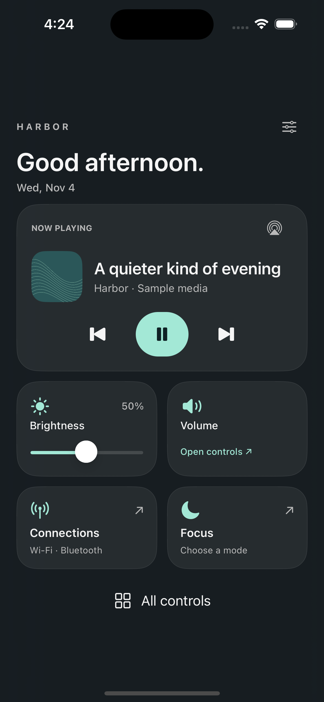

# Harbor

A quiet place for the controls you reach for most. An original, free Control Center dashboard for Chase's iPhone, inspired by the cohesive feel of Prysm and Jade. No code, artwork, or assets from either project are used.

**0.1.0~beta1 is an initial beta, not a device-validated release.** The package targets iOS **17.0** with RootHide and working SpringBoard injection. The native UI and restoration logic have been tested in an iOS 17.5 simulator harness; that is not a claim of jailbreak support for 17.5.



The screenshot uses explicitly labeled sample media and original programmatic artwork. Simulator has no hardware volume route, so the volume card shows its fallback.

## This version

- A bottom-weighted portrait dashboard with soft dark surfaces, generous touch targets, and Sea Glass, Ember, or Iris accents.
- Live now-playing title, artist, bounded artwork thumbnails, play/pause, previous, and next. Empty and unavailable states disable transport. Skip respects MediaRemote's prohibition flag.
- Brightness control with a live percentage and a 2% minimum. Native `MPVolumeView` for volume; a system-controls shortcut appears if its slider is unavailable. Native AirPlay route picker.
- Connections and Focus shortcuts restore Apple's Control Center and request the matching installed module. These are panel shortcuts, **not fake connectivity toggles**. If a module cannot be identified, the native controls remain visible.
- **All controls** restores Apple's complete Control Center for the current visit. Close and reopen to return to Harbor. Native modules and their controllers are never moved, replaced, or destroyed.
- An in-panel appearance menu and a Settings → Harbor page with a live master switch, palette, and haptics preference.
- VoiceOver labels, Dynamic Type with a single-column accessibility layout, scrollable compact layouts, Reduce Transparency, and Reduce Motion. Press feedback is an interruptible 120 ms opacity change; there is no extra entrance bounce layered onto the system gesture.

Landscape, iPad, unexpected hierarchies, and expanded native modules retain the native layout. No new activation gesture, lock-screen access override, radios implementation, or network service is installed.

## Build

From this directory:

```sh
bash scripts/check.sh
bash scripts/build.sh
bash scripts/verify-package.sh
```

Requires Xcode, RootHide-capable Theos at `$THEOS` (defaults to `/Users/chase/theos`), an `iPhoneOS17.0.sdk`, `ldid`, and Theos's normal packaging tools. `verify-package.sh` also uses Python 3 and `dpkg-deb`.

The build runs in a temporary directory because Theos does not reliably handle the spaces in `Jailbreak Tweak Repo`. It copies only Harbor's resulting package back to:

```text
packages/com.chasedavis.harbor_0.1.0~beta1_iphoneos-arm64e.deb
```

Both the tweak and preferences binary contain **arm64 and arm64e** slices. The Debian architecture is `iphoneos-arm64e`, as required by this RootHide packaging scheme. The dylib uses relocatable `.jbroot` library paths. There are no hardcoded `/var/jb` paths or install/respring scripts.

The initial beta is published through `scripts/build-harbor.sh` and the existing repository index/Pages pipeline. From the repository root, run `bash scripts/build-harbor.sh`, then `bash scripts/index-repo.sh`, then `python3 scripts/verify-harbor-repo.py`. Existing package binaries are preserved.

## Installation requirements and first device test

Nothing has been installed on Chase's phone.

1. Verify the phone's exact iOS version and that its RootHide environment can already inject tweaks into **SpringBoard**. TrollStore alone cannot load this dylib. The official [Bootstrap release notes](https://github.com/roothide/Bootstrap/releases/tag/2.0-public-beta2) document SpringBoard injection for iOS 16.0–17.0; do not infer support for other firmware or bootstrap configurations.
2. The package requires a `mobilesubstrate`-compatible injection runtime and PreferenceLoader. Install the `.deb` using the package manager inside that RootHide environment, not TrollStore's IPA installer. Enable Settings injection if required by that environment for preference bundles.
3. Restart SpringBoard through the environment's supported UI. Open Control Center in portrait. Harbor should appear only after a valid native hierarchy is detected.
4. Test **All controls first**, then close/reopen, then the master switch in Settings. Complete [DEVICE-TESTING.md](docs/DEVICE-TESTING.md) before treating it as a daily-use tweak.

To disable, turn off Settings → Harbor → Enable Harbor. To remove, uninstall `com.chasedavis.harbor` with the same package manager and restart SpringBoard through the normal supported UI. If SpringBoard cannot launch normally, use the environment's established disable-tweak/safe-mode recovery path; no device-specific recovery commands have been assumed.

## Implementation map

| File | Responsibility |
| --- | --- |
| `Tweak.xm` | SpringBoard-only, iOS 17-gated lifecycle hooks; optional activation hooks checked at runtime |
| `HBSession.m` | Host ABI/hierarchy validation, dashboard containment, exact native hidden-state restoration, native module handoff |
| `HBDashboardController.m` | Shipping UIKit interface, public brightness/volume/routing controls, accessibility, appearance menu |
| `HBMediaProvider.m` | Dynamically resolved MediaRemote, asynchronous visible-only polling, bounded thumbnail decode, timeout/stale-callback guard |
| `HBPreferences.m` | One preference domain and change notification; defaults and type validation |
| `HBPolicy.c` | Host-tested presentation eligibility, numeric clamping, command allowlist |
| `Prefs/` | PreferenceLoader registration and Settings bundle |
| `tests/PreviewMain.m` | Standalone simulator host, lifecycle/UI tests, sample-media preview; not packaged |
| `scripts/` | Local build, checks, package inspection, and simulator preview build |

Preferences use `com.chasedavis.harbor` through CFPreferences. Polling runs every two seconds for media and every 15 seconds for date/status only while Harbor is active. Artwork decode runs on a serial background queue, accepts at most 8 MiB, and creates thumbnails no larger than 320 pixels. Battery is shown only if the host already provides a valid reading; Harbor does not toggle the process-wide monitoring setting.

## Verification and limits

See [VERIFICATION.md](docs/VERIFICATION.md), [the machine-readable simulator results](docs/simulator-results.json), and [the build log](docs/build.log).

Real SpringBoard injection, host-controller dimensions and callbacks on the exact phone, authenticated/locked presentation, private MediaRemote responses, actual volume/brightness persistence, AirPlay, and conflicts with other Control Center tweaks still require device testing. The runtime guards retain native Control Center when assumptions do not hold. A successful build and mock-host test cannot prove those private APIs work on the phone.

## Simulator preview

```sh
bash scripts/build-preview.sh
# Choose an installed iOS 17 simulator; the following only targets a simulator UUID.
xcrun simctl install SIMULATOR_UUID .build/HarborPreview.app
xcrun simctl launch SIMULATOR_UUID com.chasedavis.harbor.preview
```

The harness runs its checks and saves `Documents/test-results.json` in its own simulator app container. Optional launch arguments `--large` and `--empty` show the accessibility and empty-media states. The preview is a standalone app; it does not inject into Simulator SpringBoard and is not an IPA/device installer.

## API references

The public UIKit/MediaPlayer/AVKit controls are compiled against the installed SDK. Private integration assumptions were checked against the [Control Center runtime declarations](https://github.com/nst/iOS-Runtime-Headers/blob/master/PrivateFrameworks/ControlCenterUI.framework/CCUIModularControlCenterViewController.h), [module collection declarations](https://github.com/nst/iOS-Runtime-Headers/blob/master/PrivateFrameworks/ControlCenterUI.framework/CCUIModuleCollectionViewController.h), and [Theos MediaRemote declarations](https://github.com/theos/headers/blob/master/MediaRemote/MediaRemote.h). These references are not an iOS 17 device compatibility guarantee; runtime checks and device validation remain necessary.

Free, with no paid tier. Uses the repository's MIT license.
