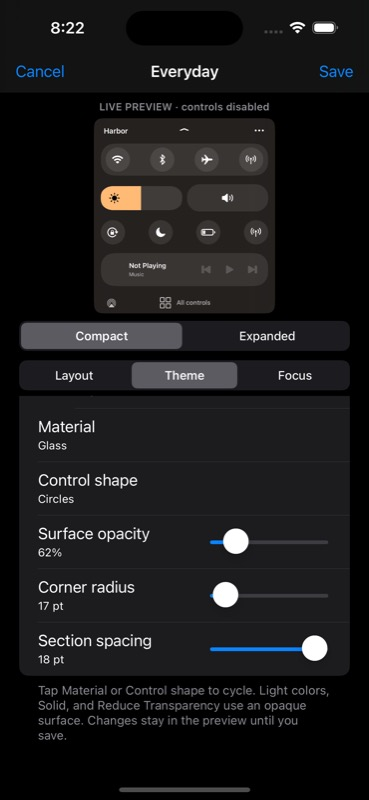

# Harbor beta5 — editor, themes, and Focus profiles

Local candidate built and checked on November 5, 2026. **Not published and not installed on a phone.** This extends the unpublished beta4 compact sheet and gesture fixes. No repository index, depiction, deployment, or remote branch was changed.

## Using the new features

Open Harbor’s ellipsis menu → **Edit layout & theme…**. The editor keeps its preview and tabs above a scrolling settings list. The preview uses the shipping renderer, disables interaction, and starts no media, clock, or Focus services. Changes stay in a draft until Save. Cancel discards the draft. Closing Control Center also discards an open draft.

- **Layout:** choose Compact or Expanded, drag the five control-group handles, and tap a group to show/hide it. Each arrangement is independent. At least one group remains visible. All controls and the editor stay outside the configurable groups. Open expanded sets the profile’s initial state.
- **Profiles:** rename, Save as new profile, or reset the current draft. Up to 12 profiles are supported. Saving selects that profile as the default. The ellipsis → Saved profiles menu also switches defaults, edits a different profile, and deletes a profile after confirmation. The last profile cannot be deleted. Copying a draft preserves the original saved profile; deleting a profile removes its Focus links.
- **Theme:** Sea Glass, Graphite, Iris, and Ember presets; custom accent/surface colors through UIKit’s color picker; Glass, Soft, or Solid material; circular or softly squared buttons; surface opacity, sheet radius, and section spacing. Text and active-control ink adapt to the selected colors. Light surfaces, Solid, and Reduce Transparency are opaque; the opacity control is disabled in those cases. Preview updates coalesce to 30 Hz and reuse track images when their colors have not changed.
- **Focus:** enable automatic matching and tap a mode returned by iOS to link it to the edited profile. Saved links can be removed. Exact identifiers are used, never inferred from display names. Focus off, an unlinked Focus, or an unavailable service uses the default profile. A linked Focus takes precedence over manual default selection. Changes defer while a control is held, scrolling decelerates, or the editor is open.

The editor currently rearranges **five control groups**, not arbitrary individual system modules: Connections, Brightness & volume, Essentials, Now Playing, and More shortcuts. The real-control adapter and native fallback behavior from beta4 remain in use.

Settings → Harbor retains Enable, Gentle haptics, and SpringBoard status. Theme/profile editing lives in Harbor. The old palette preference seeds the initial profile when no profile library has been saved.

## Focus support and its limit

Apple’s public [INFocusStatus](https://developer.apple.com/documentation/intents/infocusstatus) and the installed iOS 17.0 header expose an optional focused/not-focused value, not a selected mode identifier. Harbor therefore has an optional, runtime-checked, **read-only** DoNotDisturb adapter for its existing SpringBoard process. It does not add entitlements, impersonate another client, activate Focus, or bypass authorization.

The adapter validates class/method signatures, queries on a serial background queue, uses a two-second UI timeout and generation checks, listens only while Harbor is active, and removes its listener on closing. Optional mode enumeration uses returned configurations. If enumeration fails, an actually returned active identifier can still be linked. If live subscription fails but a state query works, the status explains that reopening is required to refresh. Slow results never block the main thread. Interface exceptions and missing/unknown state select the default layout.

Interface evidence:

- [DNDStateService](https://github.com/MTACS/iOS-17-Runtime-Headers/blob/main/PrivateFrameworks/DoNotDisturb.framework/DNDStateService.h), [DNDState](https://github.com/MTACS/iOS-17-Runtime-Headers/blob/main/PrivateFrameworks/DoNotDisturb.framework/DNDState.h), and [listener protocol](https://github.com/MTACS/iOS-17-Runtime-Headers/blob/main/protocols/DNDStateUpdateListener.h).
- [DNDModeConfigurationService](https://github.com/MTACS/iOS-17-Runtime-Headers/blob/main/PrivateFrameworks/DoNotDisturb.framework/DNDModeConfigurationService.h) and [DNDMode](https://github.com/MTACS/iOS-17-Runtime-Headers/blob/main/PrivateFrameworks/DoNotDisturb.framework/DNDMode.h).
- All required optional classes exist in the installed iOS 17.0 DoNotDisturb SDK exports. These checks establish interface evidence, not entitlement availability or device behavior.

**The real iOS 17.5 simulator app query failed with `BSServiceConnectionErrorDomain (3)`.** Harbor reported the unavailable state and retained its default. No privileges were changed to work around it. See [the captured probe](beta5/ui-real-focus-unsupported.json). Automatic real-system Focus changes remain **unverified in SpringBoard on the phone**. Fixture modes are explicitly labeled Simulated Work/Personal and are compiled only into `tests/ProfilesMain.m`, never the package.

## Validation

- [93 UIKit checks, zero failures](beta5/simulator-results.json): native hierarchy/geometry, handoff, restoration, widths 300–430 pt, large text, four themes, minimum visible groups, light-color contrast, inactive previews, revision conflicts, stored-data/backup recovery, and deferred Focus transitions. [Runtime log](beta5/simulator-runtime.log) has no unbalanced appearance, Auto Layout conflict, or exception reports in this run.
- [20 C policy checks and 23 Foundation profile checks](beta5/host-checks.txt), with AddressSanitizer/UndefinedBehaviorSanitizer. The profile checks include a 100-case numeric normalization matrix, malformed schemas, duplicate IDs, bounds, dangling links, exact Focus matching, and default selection.
- [14 assertions against captured interactive results](beta5/interaction-validation.json), from actual Simulator UI input. These are evidence checks, not a substitute for rerunning the UI workflow.
- Created and named Work through the editor, hid Connections in Compact, dragged Now Playing to the first position, and verified Expanded stayed unchanged. Selected all three alternate presets and a custom `#FFA57D` accent through UIKit’s picker. Saved and relaunched; original Everyday remained intact.
- Cancel discarded a changed preset. A Focus event injected while the actual editor was open set a pending transition without changing the displayed profile or draft. Closing the editor applied Work with the same saved library/revision. Deleting Work through its confirmation removed the dangling link and returned to Everyday.
- Actual theme-slider drags saved opacity **0.617574**, sheet radius **16.9868**, and spacing **17.703**. A fast-release problem was found during testing and fixed by committing the final finger position. Direct accessibility `setValue` alone did not emit UIKit value-change events in this automation environment and was **not** accepted as successful persistence evidence.
- In the 568 pt-high fixture with the largest accessibility text category and customized spacing, an HID swipe produced **Harbor pan 1, native pan 0, offset 163.67**, and made the final Display control fully visible. A subsequent actual tap restored the native fixture and requested `com.apple.control-center.DisplayModule`. [Scroll](beta5/ui-large-short-scroll.json), [handoff](beta5/ui-display-handoff.json).
- The one synthetic scrolling capture sampled 72 display-link intervals, with largest measured gap 16.67 ms. This is a small simulator diagnostic, **not a device frame-rate or sustained performance guarantee**.



Screenshots and control states here are simulator fixtures. The short-window screenshots intentionally leave unused display area outside the 568 pt test window. No physical device or real radio/media effect is represented by them.

## Package and reproduction

`packages/com.chasedavis.harbor_0.1.0~beta5_iphoneos-arm64e.deb`

- Size: **98,858 bytes**.
- SHA-256: **23b316236d5d680b2fd5f697d12b0cb6ef527a8ae50de07b2d34d5a423a2a7f7**.
- Debian architecture: `iphoneos-arm64e`; dylib and preferences bundle each contain arm64 + arm64e.
- Depends: firmware >=17.0 and <17.1, mobilesubstrate, preferenceloader. Requires an existing RootHide setup capable of SpringBoard injection; TrollStore alone is insufficient. Settings injection must be enabled where required by that environment.
- [Build manifest](beta5/build-manifest.json), [build log](beta5/build.log), [package inspection](beta5/package-verification.txt). Exact six-file payload, SpringBoard-only filter, PreferenceLoader registration/schema, relocatable RootHide paths, architectures, and dependency metadata passed. No installation/respring script. Theos emits its existing obsolete linker flag and sandbox CPU-query warnings; the build and package verification succeed.

```sh
bash scripts/check.sh
bash scripts/build.sh
bash scripts/verify-package.sh packages/com.chasedavis.harbor_0.1.0~beta5_iphoneos-arm64e.deb
HARBOR_PREVIEW_APP=/tmp/harbor-check/HarborPreview.app bash scripts/build-preview.sh
HARBOR_PREVIEW_MAIN=tests/ProfilesMain.m HARBOR_PREVIEW_APP=/tmp/harbor-edit/HarborPreview.app bash scripts/build-preview.sh
```

Use a dedicated iOS 17.5 simulator. The normal harness writes `Documents/test-results.json` and restores its prior profile library after testing. The interactive harness writes `profile-interactions.json` and `gesture-results.json`. `--focus-fixture` enables labeled simulated modes; `--focus-during-edit` sends a delayed simulated update during editing; `--short`, `--large`, and `--expanded` exercise overflow; `--reset-profiles` clears only that preview app’s profile test data. Without `--focus-fixture`, the actual read-only Focus adapter is probed. The harness is not an installable SpringBoard tweak or a phone test.

## Readiness

The editor, theme, persistence, and fixture transition flows pass the recorded simulator checks. **Real Focus subscriptions/identifiers, iOS 17.0 RootHide injection, lock-screen transitions, radio/volume/media/AirPlay effects, conflicting tweaks, and physical-device frame pacing still require a device beta test.** The simulator does not prove those behaviors or justify calling the tweak perfected/release-ready. Publication and phone installation remain unperformed.
